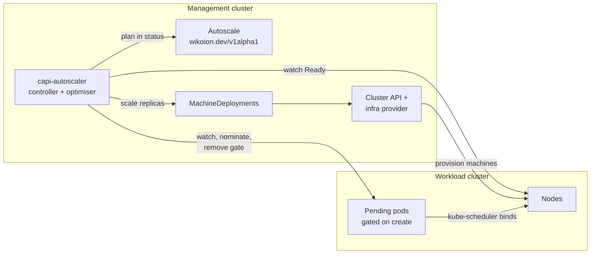
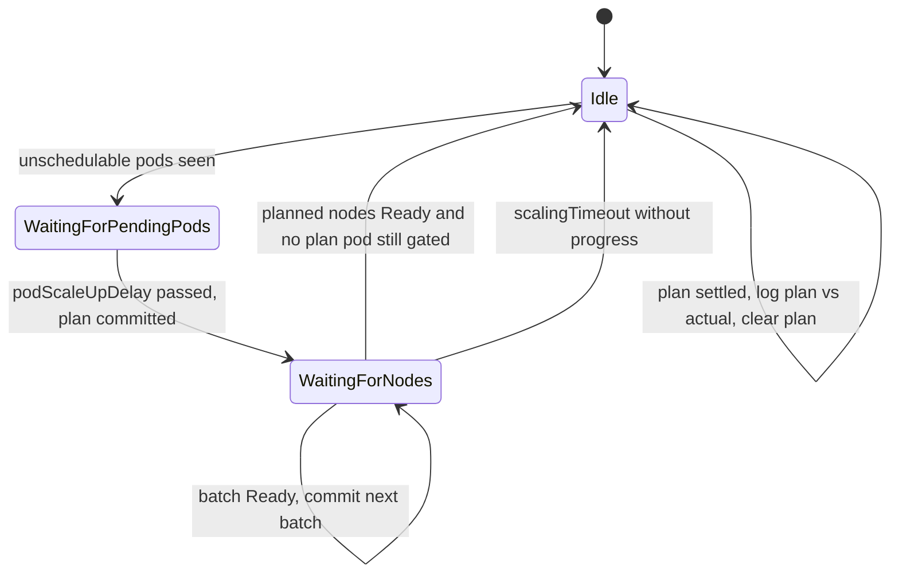
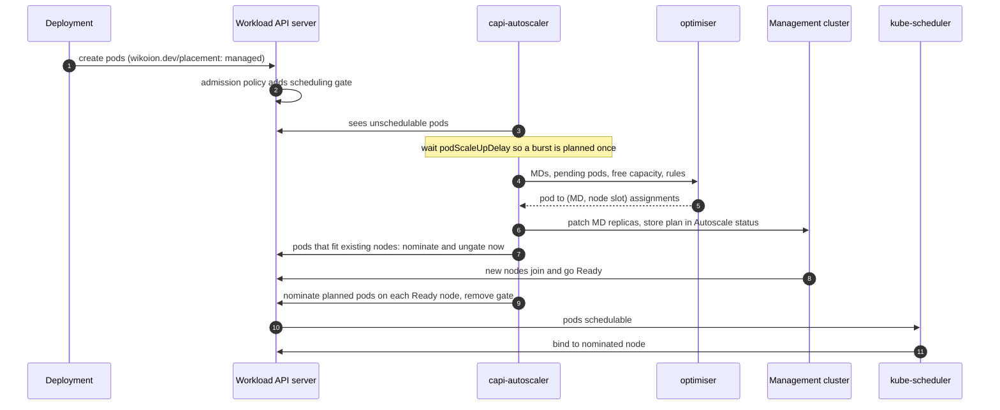
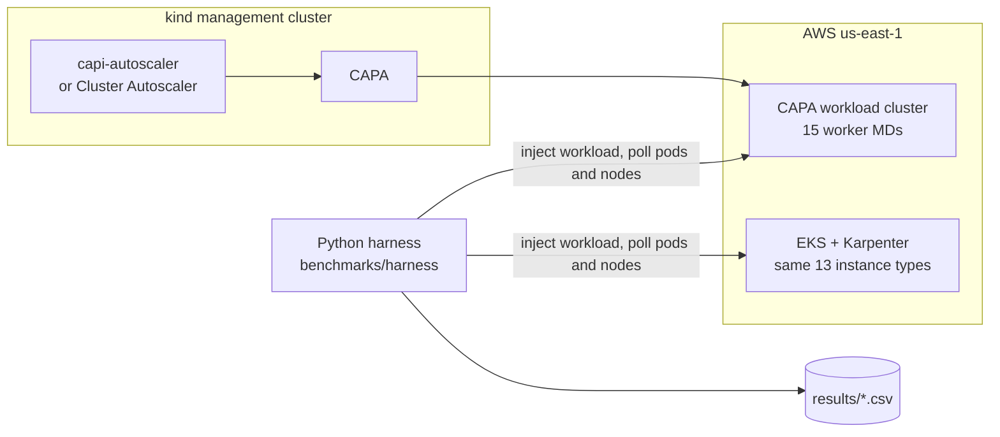

<div align="center">

# capi-autoscaler

**Optimising Kubernetes cluster resource utilisation with constraint programming autoscaling**

[](#roadmap)
[](LICENSE)
[](https://doc.rust-lang.org/edition-guide/rust-2024/)
[](#requirements)
[](https://cluster-api.sigs.k8s.io/)
[](https://developers.google.com/optimization/cp/cp_solver)

</div>

capi-autoscaler is a cloud-agnostic Cluster API (CAPI) autoscaler that models scaling decisions as a multidimensional bin-packing problem and solves it using Google's OR-Tools CP-SAT library with a bounded time limit. It implements a beam-search heuristic as a fallback and warm solver hint. Node scaling is enacted by incrementing CAPI MachineDeployment replica counts. To control pod placement in the cluster, new pods have a scheduling gate applied by a MutatingAdmissionPolicy. When nodes become ready, the capi-autoscaler reads the plan and sets `status.nominatedNodeName` on each pod before removing the scheduling gate. This approach steers pods to the desired node while keeping the Kubernetes scheduler as the ultimate authority.

> [!NOTE]
> capi-autoscaler is alpha and its API is `wikoion.dev/v1alpha1`. As of the time of writing, capi-autoscaler does not implement scale-down consolidation.

## Contents

- [Results](#results)
- [Why](#why)
- [Features](#features)
- [Architecture](#architecture)
- [How it works](#how-it-works)
- [Design decisions](#design-decisions)
- [Getting started](#getting-started)
- [Configuration](#configuration)
- [Benchmarks](#benchmarks)
- [Testing](#testing)
- [Roadmap](#roadmap)
- [About](#about)
- [Contributing](#contributing)
- [Licence](#licence)

## Results

The system was evaluated on real AWS EC2 infrastructure and compared against the Cluster Autoscaler and Karpenter across three workload profiles of increasing scheduling complexity (unconstrained, light-constrained and heavy-constrained), each run at three pod counts: 25, 50 and 100. The capi-autoscaler and Karpenter both completed every scenario; however, two of the ten Cluster Autoscaler runs in the heavy-constrained 100-pod scenario exceeded the 900-second harness timeout. The capi-autoscaler recorded the highest CPU utilisation in all nine scenarios and a lower mean estimated fleet rate than Karpenter in all nine scenarios and than CA in the scenarios CA completed. Karpenter had the lowest scale-up latency in every scenario.

| Profile | System | 100-pod latency | Workers | CPU util. | Memory util. | Est. fleet rate |
|---|---|---:|---:|---:|---:|---:|
| Unconstrained | **capi-autoscaler** | 128.4 s | **24.0** | **84.0%** | **76.6%** | **$3.21/h** |
| Unconstrained | Karpenter | **66.7 s** | 27.5 | 69.1% | 64.8% | $5.38/h |
| Unconstrained | CA | 395.6 s | 47.4 | 46.5% | 52.3% | $7.03/h |
| Light-constrained | **capi-autoscaler** | 176 s | **24.9** | **82.5%** | 19.7% | **$3.07/h** |
| Light-constrained | Karpenter | **82.6 s** | 28.1 | 75.5% | **33.4%** | $3.94/h |
| Light-constrained | CA | 156.7 s | 29.0 | 68.5% | 31.8% | $4.20/h |
| Heavy-constrained | **capi-autoscaler** | 140.2 s | **26.6** | **80.7%** | **74.7%** | **$3.59/h** |
| Heavy-constrained | Karpenter | **80.5 s** | 38.2 | 59.4% | 57.7% | $4.83/h |
| Heavy-constrained | CA | 447.0 s (8/10, 2 timeouts) | 60.4 | 32.7% | 42.1% | $9.93/h |

<sub>Benchmark results from 10 end-to-end test sweeps for each autoscaler.</sub>

Enabling placement control reduced the mean 100-pod fleet in every profile compared with the provisioning-only build, for example from 29 to 24 workers and from $3.78/h to $3.21/h in the unconstrained profile. Consolidation narrows Karpenter's efficiency deficit, but the capi-autoscaler still has the lower mean fleet cost in all nine current consolidation comparisons without any post-provisioning draining required.

The methodology, the full dataset and the notebook that produces every number are in [capi-autoscaler-research](https://github.com/wikoion/capi-autoscaler-research).

## Why

Cluster Autoscaler and Karpenter, the two node autoscalers currently sponsored by SIG Autoscaling, are heuristic. The Cluster Autoscaler (CA) selects a node group to expand by running Kubernetes scheduler simulations against candidate templates and applying optional expander policies to influence scaling decisions. Karpenter batches up pending pods and greedily bin-packs them onto the cheapest available instance types that satisfy their scheduling constraints.

Both systems share design limitations: they choose which nodes to scale, but the Kubernetes scheduler chooses where the pods are placed. When the scheduler binds pods differently from what the autoscaler simulated, for example, because nodes become Ready in an unexpected order, the realised utilisation can be worse than the plan, and the autoscaler may have to commit more nodes than originally planned. Further, since both autoscalers greedily pack pods, the solutions are not guaranteed to be globally optimal.

capi-autoscaler models scale-up decisions as an optimisation problem. Pending pods have CPU and memory requirements and scheduling constraints; candidate node groups have finite capacities, maximum replica limits and configured hourly prices. Considered this way, the problem clearly fits as a multidimensional bin-packing problem, which is NP-hard but practical to solve near-optimally with modern constraint solvers. I couldn't find a published system that combines all three: CP-SAT optimisation of node scale-up, CAPI to interact with the cloud provider APIs and an in-cluster placement control mechanism.

## Features

1. **Optimiser library (the `optimiser` crate):** Provides a CP-SAT model for scaling nodes as a bin-packing problem over existing capacity and candidate node groups. It covers CPU and memory fit, pod and node affinity and anti-affinity, topology spread constraints and node cost. It uses a beam-search heuristic that provides a warm start hint and can function as a standalone fallback solver.
2. **Kubernetes controller (the `autoscaler` crate):** A Kubernetes controller that runs in a management cluster and watches a remote workload cluster. It batches unschedulable pods, calls the optimiser and scales new nodes by patching the Cluster API MachineDeployment replicas. The controller implements placement control via scheduling gates, which a MutatingAdmissionPolicy injects into pod specs at creation time. The controller watches for each planned node to become ready, computes which pods should schedule, sets `status.nominatedNodeName` and removes the gate. Pods with topology spread constraints are released round-robin across zones so that nomination order is less likely to violate skew constraints.
3. **Upstream contributions (`cp-sat` crate):** Bindings for some CP-SAT functions were missing from the crate, so these were contributed as part of the project.

## Architecture

The system consists of two Kubernetes clusters. The management cluster acts as the control plane. The autoscaler runs here, alongside the CAPI and CAPA controllers, the MachineDeployment, MachineSet, Machine and MachineTemplate resources and the Autoscale custom resource, which is what provides the configuration inputs for the autoscaler. The workload cluster is where production workloads live. The autoscaler can read all required resources by creating two clients: one for the local management cluster, which reads MachineDeployments (MDs), and a second for the remote cluster, which uses a kubeconfig secret. It creates a reflector store that watches for pending workload cluster pods. The controller never provisions infrastructure directly; it patches MachineDeployment (MD) replica counts and CAPI/CAPA reconcile the difference into EC2 instances that join the workload cluster.



All Kubernetes logic is in the `autoscaler` crate. The `optimiser` crate only depends on the CP-SAT binding and anyhow. `lib.rs` defines the API-boundary types (`MachineDeployment`, `ExistingSlot`, `Pod`, `TopologyGroup`, `AffinityGroup`, `OptimiserConfig`, `SolverResult`), `optimise.rs` builds the CP-SAT model, `solver.rs` orchestrates the attempt loop and `beam_search.rs` implements the heuristic. The `autoscaler` crate contains the controller (`controller.rs`), the translation between Kubernetes and optimiser crate resource types (`optimiser.rs`), the CRD types, kopium-generated CAPI bindings, and a `crdgen` binary that produces the CRD YAML.

## How it works

### Reconciliation

Reconciliation progresses through three states:

1. **Idle.** No work. Pod events move the state to WaitingForPendingPods.
2. **WaitingForPendingPods.** When the autoscaler detects pending pods, it waits for the duration of `podScaleUpDelay` for them to accumulate, so one solve covers a batch. When the delay elapses the controller builds the solver input, calls the optimiser library, patches MD replicas, writes the plan and placements into the Autoscale resource's status field and then transitions to WaitingForNodes. Pods that fit existing free capacity are nominated immediately.
3. **WaitingForNodes.** The controller tracks scaling progress by counting Ready Kubernetes nodes within the workload cluster. CAPI `readyReplicas` is not relied upon because CAPA can report Machines as ready before they are actually schedulable in the workload cluster. `unreadyNodeLimit` exists as a circuit breaker and batching mechanism for node scaling, so a provisioning problem can't accumulate too many unready nodes. When nodes become ready, matching pods from the plan are nominated and have their scheduling gates removed. If `scalingTimeout` expires, the current plan will expire and a replan will be forced. When the plan is satisfied and no planned pods remain gated, it reports plan-versus-actual placement, clears state and returns to Idle.





### Placement control

Placement control turns the solver's per-pod intent into realised placement without ever taking authority away from the scheduler.

1. **Gating:** Pods labelled `wikoion.dev/placement: managed` receive a scheduling gate `wikoion.dev/placement` at admission, injected by a MutatingAdmissionPolicy with `failurePolicy: Ignore` and a match condition that skips pods that already have a `nodeName`. The controller applies the policy at startup. If the policy or its beta API is absent, pods simply schedule normally.
2. **Planning:** PlannedPlacement entries in the Autoscale resource's status carry the pod, its MachineDeployment, the solver slot index for new-node placements, the owning Deployment (resolved from Pod to ReplicaSet to Deployment) and a timestamp. Pods sharing a slot index are intended to share a node.
3. **Claiming and nomination:** As each new node becomes Ready, it claims the first unclaimed slot for its MachineDeployment, provided the node was created after the plan. The pods of that slot are nominated (`status.nominatedNodeName` set through the status subresource) and then ungated. Used slots live in an in-memory map of (MachineDeployment, slot) to node, and a nomination timestamp per pod.
4. **Event-keyed, not recomputed:** The design avoids recomputing placement decisions each reconciliation. When nodes become ready, their events fire. Nominations and claims are recorded in the done set. Recomputation of the claims and nomination only happens if the controller crashes. The controller rebuilds its in-memory map by checking which pods already nominate which nodes, finishes any in-progress node nominations and un-gates the pods.
5. **Zone-spread pod nomination order:** Pods with non-hostname-keyed topology spread can't be released immediately when their nodes arrive. If one domain's nodes become ready before others, the scheduler would bind pods there until `maxSkew` blocks the rest of the placements. This would likely cause plan deviation and reduce packing quality. Pod deployments that carry those constraints are therefore held until every slot that has a participating domain has a claimed node, then pods are nominated round-robin across domains. At the end of the cycle, if there are any straggler pods, they are all released.
6. **Nomination clean-up:** The controller will clear nominations that cannot be honoured: if the node no longer exists, or if the pod no longer fits in the node's free capacity. Pods are given a 120-second grace period as a backstop before nominations are removed. This covers other cases not directly checked; however, the scheduler should take over and place the pod somewhere else before this.

The process is designed to fail open: each mechanism, gate injection, nomination and release ordering, either works or leaves the pod to the default scheduler.

<details>
<summary><b>Solver input construction</b></summary>

Solver input is constructed by parsing four resource types across the two clusters. From the management cluster: MDs carry the CPU and memory capacity (from Cluster Autoscaler-compatible capacity annotations) and hourly cost (`wikoion.dev/cost-per-hour`). Maximum scale out is calculated from maxReplicas. MachineSets must be matched to owning MDs because nodes within the workload cluster only report their owning MachineSet, not their owning MD. From the workload cluster, nodes are matched to their owning MDs through MachineSets and pods are parsed for their resource requests, labels and scheduling constraints.

Three details are important for correctness:

1. **Existing free capacity:** Each Ready node is presented to the solver as an existing slot with its free (not total) capacity, computed from the requests of bound pods plus pods currently nominated to it. The solver can therefore fill gaps in the current nodes before provisioning new nodes. New nodes it provisions incur a cost, while existing ones are considered a sunk cost.
2. **DaemonSet overhead:** The controller lists workload-cluster DaemonSets, sums per-node requests for each whose node selectors match a given MachineDeployment's labels, and subtracts that sum from each node's capacity accordingly. Selector keys the MachineDeployment does not declare are treated as matching, and a warning is logged, because undercounting the DaemonSet overhead makes every new node smaller than the solver believes it to be and leads to underprovisioning.
3. **The allowed matrix:** A Boolean tensor over (pod, MachineDeployment, slot) encodes hard eligibility: node selectors, node affinity, resource fit and anti-affinity against running pods. Disallowed combinations are pinned to zero before search begins, which both enforces correctness and shrinks the search space.

</details>

<details>
<summary><b>The CP-SAT model</b></summary>

The model (built in `optimiser/src/optimise.rs`) has two main collections of Boolean variables: `slot_used[md][slot]`, one per candidate slot, and `pod_slot_assignment[pod][md][slot]`. Slots represent an available replica in an MD and index existing nodes first, then up to `max_scale_out`. Slots will become nodes in the workload cluster.

Constraints:

1. **Assignment:** each pod's assignment variables sum to exactly one, or at most one when partial placement is permitted, in which case unplaced pods incur a large objective penalty.
2. **Capacity:** for each slot, the sum of assigned CPU and memory requests, scaled to integers, must not exceed the slot's capacity. Template slots have their capacity reduced by subtracting an allocatable fraction and DaemonSet overhead; existing slots carry their measured free capacity. `slot_used` is tied to assignments in both directions so an empty slot costs nothing.
3. **Symmetry breaking:** unused slots of the same MD are interchangeable, so the model forces them to be used in order (slot i+1 used implies slot i used). This removes symmetry across identical permutations that would otherwise inflate the search space. Existing slots are excluded from this because their capacity can differ.
4. **Pairwise anti-affinity:** hostname-scoped anti-affinity pairs get a clause that enforces at most one pod per slot.
5. **Affinity groups:** for pod affinity that is not keyed on hostname, affinities are modelled over topology domains, e.g. zones. Each slot carries a domain label and running pods are counted per domain to form a baseline. Pods carrying anti-affinity are excluded from slots whose domain contains a peer matching the affinity selector. For affinity (colocation), a carrier (pod carrying the affinity term) may land in a domain only if a peer lands there. If no baseline pods exist for a domain, all peers will be forced to land in the same domain.
6. **Topology spread** works similarly to affinity groups. Slots are assigned domains based on the labels of their carrying MD. For existing slots, node labels are also taken into account in case they differ from their carrying MD. Baseline counts of currently running pods are collected from each domain. Groups with required topology-spread constraints are forced to `max - min <= maxSkew`; groups with preferred constraints receive a flat objective penalty for violating skew.

**Objective:** Minimise the provisioned cost of new nodes, using the hourly cost annotations applied to MDs. If hourly cost is absent from MDs, then a formula of 4 x CPU + 1 x memory will be used to calculate waste. As well as the primary minimisation objective, the model will also minimise optional scores biasing certain MD types (plugins), soft (preferred) pod affinity penalties and soft topology slack. Existing nodes contribute nothing to the objective. They are considered a sunk cost, which pushes the model to prioritise filling those slots.

**Solve configuration:** The solver is time-limited by the configurable `solverTimeout` (30 seconds in the benchmark environment). The random seed is fixed at 1729 with search randomisation disabled to ensure runs are deterministic. Worker count is set directly from the container's cgroup CPU quota by reading from `available_parallelism`, because CP-SAT's own detection sees host cores and oversubscribes a quota-limited container.

**A working example:** Consider the following scenario: there are three pending pods, two of them requesting 1.5 CPU / 2Gi and one requesting 2.5 CPU / 12Gi. There is one existing m6i.large node (2 CPU, 8Gi) with 1.6 CPU / 6Gi free. There are two candidate MachineDeployments: m6i.large at $0.096/h and r5.xlarge (4 CPU, 32Gi) at $0.252/h. The allowed matrix admits every pod on any node on which it can physically fit, the 2.5-CPU pod is too large to fit on m6i.large slots, so it fails resource fit and those slots are pinned to zero. One 1.5-CPU pod fits the existing node's free capacity, so its slot cost is zero. The remaining 1.5-CPU pod and the 2.5-CPU pod both need new capacity: a single r5.xlarge (cost 0.252) holds both at exactly 4 CPU and 14Gi, while the alternative, one m6i.large for the small pod plus one r5.xlarge for the large (0.096 + 0.252), is strictly worse, so the solver returns one existing-slot assignment and one new r5.xlarge carrying two pods. If the two 1.5-CPU pods carried hostname anti-affinity, the at-most-one clause on each slot would prevent them from being placed on the same node and force a two-node solution instead.

</details>

<details>
<summary><b>Beam search</b></summary>

The beam-search heuristic (`optimiser/src/beam_search.rs`) operates on the same input model and serves three roles: warm-start hint for CP-SAT, standalone solver, and bounded fallback when CP-SAT produces no acceptable solution in the given time budget.

Pods are ordered first by most constrained, then by affinity participation, then by scarcity of placement availability (pods with few possible slots), then size, with affinity peers forced ahead of pods carrying affinity terms. Each beam state tracks every slot's remaining capacity and pod counts per affinity and topology domain, so that placement feasibility can be checked exactly during execution. Filling already used slots is preferred, scored by utilisation; when nothing fits, the next-best new node is added. States are scored by provisioned cost plus a strong bias towards fewer nodes and topology penalties. Beam width is set to 4. The results of the search convert directly into a CP-SAT solution hint.

The design intent is to provide a reasonable starting point to CP-SAT, hopefully to decrease the time required to find an optimal solution, and also to provide a fallback should CP-SAT not be able to provide a feasible solution. In reality, since pods are batched, CP-SAT should be able to find reliable solutions; however, this reduces the blast radius, allowing scaling to continue in the event of a failure.

</details>

## Design decisions

1. **Nomination over binds:** The original design used `spec.nodeName`, applied by an in-cluster mutating webhook. This would bypass all checks by the Kubernetes scheduler and the pod would either schedule onto a node or sit in pending if it couldn't. `nominatedNodeName` provides a much more graceful mechanism; the scheduler will honour the placement if it possibly can; otherwise, the scheduler can place the pod somewhere else. The webhook itself was replaced by internal controller logic and MutatingAdmissionPolicy applying a scheduling gate. This removes all the complexity of managing a webhook: there are no certificates to manage and no pod placement failures if the webhook is unreachable.
2. **Provider-agnostic:** By using Cluster API, the system has all the benefits of mature cloud-provider provisioning and API interaction. Writing provider-specific provisioning code would have substantially increased project scope and complexity and tightly coupled the project to a specific cloud provider. The trade-off is less provisioning flexibility than Karpenter since instance shapes are predefined by MachineDeployments.
3. **In-memory placement state:** This trades the simplicity and correctness benefits of avoiding persisted controller state for the cost of rebuilding it after restart. This is acceptable because the durable nomination state remains in the Kubernetes API, allowing the in-memory claims to be reconstructed after a restart.

<details>
<summary><b>Why Rust</b></summary>

The project required extensive interaction with Kubernetes APIs, so a language with a mature Kubernetes library was essential. That narrowed down the choices to Go and Rust. Go has extremely comprehensive library support for writing Kubernetes controllers and is by far the most popular choice. However, it lacks direct CP-SAT bindings that can be consumed as modules. Google does maintain bindings, but they require using the Bazel build system, which introduces significant complexity. An alternative to the Google bindings would be to write the Solver model in C++ (OR-Tools native language), but it would require wrapping it with an extern "C" interface and writing a CGO wrapper. Go also suffers from overheads when interacting with libraries across the CGO boundary. Rust has less comprehensive Kubernetes support than Go, but the kube-rs crate is mature and provides all the essential functions required to interact with the Kubernetes API. Rust also has CP-SAT bindings via the cp-sat crate, which, although not complete, required only minimal upstream contributions to support everything required by this project. Rust was chosen due to its straightforward interaction with OR-Tools, performance and Kubernetes support, accepting the trade-off of having to write more code to handle Kubernetes API interactions than would be required in Go.

</details>

## Getting started


### Requirements

- Rust with edition 2024 support.
- [OR-Tools](https://developers.google.com/optimization) 9.14 C++ libraries in `/opt/or-tools/current`. All three `.cargo/config.toml` files link against that path, and the Dockerfile installs `or-tools_amd64_debian-12_cpp_v9.14.6206` there.
- A Cluster API management cluster with MDs to scale.
- Kubernetes 1.35 on the workload cluster for placement control, with `MutatingAdmissionPolicy=true` and the `admissionregistration.k8s.io/v1beta1` runtime config on the API server. It's GA at v1 from 1.36.

### Build

```sh
cd autoscaler
cargo build --release
cargo run --bin crdgen > crds/autoscaler-crds.yaml
docker build -t capi-autoscaler:dev .
```

The Dockerfile packages the binary from `target/release/`, so build it on the host first.

### Run locally with kind and CAPD

```sh
cd autoscaler
make dev                        # kind management cluster, CAPI with the docker provider, Tilt
make apply-test-cluster         # CAPD workload cluster plus an example Autoscale
make wait-for-workload-cluster
make install-cni
make demo-apply                 # a workload that triggers a scale up
make demo-watch
```

> [!TIP]
> CAPD nodes report the host's capacity, so the scheduler ignores the node sizes the solver planned for. Use CAPD to test the control loop and AWS to test placement.

## Configuration

The Autoscale CRD (group `wikoion.dev`, version `v1alpha1`, defined in `autoscaler/src/api/autoscale_types.rs`) defines the configuration: `podScaleUpDelay` (batching window), `scanInterval`, `scalingTimeout`, `solverTimeout`, `maxScaleOut` (replicas committed per batch), `unreadyNodeLimit` and a node selector. Status records conditions, the current `scalingPlan` (per-MachineDeployment targets) and `plannedPlacements` (per-pod intents).

The benchmark configuration is `podScaleUpDelay` 5s, `solverTimeout` 30s, `scanInterval` 10s, `unreadyNodeLimit` 5, `scalingTimeout` 10m, and `maxScaleOut` 40, set high so an entire scale-up commits in one batch, because the baselines have no batch limit and a lower cap would handicap only this system.

```yaml
apiVersion: wikoion.dev/v1alpha1
kind: Autoscale
metadata:
  name: bench-cluster-autoscale
  namespace: default
  labels:
    wikoion.dev/cluster-id: bench-cluster
spec:
  podScaleUpDelay: 5s
  scanInterval: 10s
  unreadyNodeLimit: 5
  scalingTimeout: 10m
  solverTimeout: 30s
  maxScaleOut: 40
```

| Environment variable | Description |
|---|---|
| `REMOTE_CONFIG_PATH` | Path to the workload cluster kubeconfig. Mounting the CAPI `<cluster>-kubeconfig` secret works |
| `CLUSTER_ID` | Matched against the `wikoion.dev/cluster-id` label on MDs and on the `Autoscale` resource |
| `NAMESPACE` | Namespace of the MDs and the `Autoscale` resource on the management cluster |
| `RUST_LOG` | Log filter, e.g. `info,capi_autoscaler=debug` |

| MachineDeployment key | Kind | Description |
|---|---|---|
| `wikoion.dev/cluster-id` | label | Puts the MD under this controller |
| `capacity.cluster-autoscaler.kubernetes.io/cpu` | annotation | Node CPU, needed to scale from zero |
| `capacity.cluster-autoscaler.kubernetes.io/memory` | annotation | Node memory, needed to scale from zero |
| `cluster.x-k8s.io/cluster-api-autoscaler-node-group-max-size` | annotation | Replica ceiling |
| `wikoion.dev/cost-per-hour` | annotation | Optional. Real price per node, makes the objective $/h |

`benchmarks/manifests/capi-autoscaler-deployment.yaml` is a working Deployment with RBAC. Label pods with `wikoion.dev/placement: managed` to opt them into placement control. Deleting the `Autoscale` resource doesn't remove the admission policy.

## Benchmarks

**Reproducible benchmark harness:** For each run, the harness provisions a local management cluster and a real AWS EC2 instance workload cluster using CAPI. Workloads run against all three autoscalers; metrics are collected in CSV files and a Jupyter notebook generates every figure, table and summary from the output data.



The end-to-end benchmarks measure the controller and provisioning path. Two offline replay suites use the same optimiser code and workload/profile generators as the cluster harness. These experiments isolate algorithm behaviour from EC2 provisioning and scheduler timing while preserving the model structure used by the CAPI autoscaler.

| Benchmark | Command | Needs |
|---|---|---|
| Solver scaling across pods, MDs and slots | `make -C benchmarks solver-bench-rq2` | cargo, OR-Tools |
| Beam search vs CP-SAT by time budget | `make -C benchmarks solver-bench-rq3` | cargo, OR-Tools |
| Consolidation headroom | `make -C benchmarks solver-bench-rq4` | cargo, OR-Tools |
| End to end, capi-autoscaler | `make -C benchmarks bench-capi` | AWS |
| End to end, Cluster Autoscaler | `make -C benchmarks bench-cas` | AWS |
| End to end, Karpenter | `make -C benchmarks bench-karpenter` | AWS |

The end-to-end runs need an AWS account and `aws-vault`, `kind`, `kubectl`, `clusterctl`, `clusterawsadm`, `eksctl`, `helm`, `jq`, `envsubst`, `docker` and `python3`:

```sh
export BENCH_AWS_PROFILE=<aws-vault profile>
export AWS_SSH_KEY_NAME=<EC2 key pair in us-east-1>
make -C benchmarks mgmt-cluster-create
make -C benchmarks bench-capi PROFILE=heavy-constrained RUNS=3 PODS=100
make -C benchmarks cleanup
```

> [!WARNING]
> The end-to-end benchmarks create real EC2 instances and an EKS cluster. Bench targets tear their clusters down afterwards unless you pass `TEARDOWN=0`. As of Aug 2026 a run cost about $1.15, plus anything left running.

## Testing

The `optimiser` crate contains 49 integration tests (`optimiser/tests/solver_test.rs`) covering the solver modes (CP-SAT only, beam only, hybrid with hint, score-only), capacity and existing-slot packing, hard anti-affinity, affinity group colocation rules, topology spread, partial placement and validation checks for malformed input. The translation layer contains tests for node-to-MachineDeployment matching, computation of existing slots that factors in pending and deleted pods, and scale-up scenarios such as preferring existing capacity. The `autoscaler` crate also contains unit tests for the placement-control behaviour, including identifying pods still awaiting release, topology-spread coordination and round-robin release across domains.

## Roadmap

The main future engineering priority is proactive scale-down. The 600-second offline benchmarks show that a background optimisation pass can find a lower-cost fleet than either the measured capi-autoscaler or consolidated Karpenter in the tested heavy-constrained case. A real implementation would need to repack running pods subject to PodDisruptionBudgets, but unlike scale-up it could use a substantially larger solver budget because it is outside the time-critical scale-up path.

Further evaluation should randomise the placement-control A/B comparison, increase the consolidation sample and repeat the main sweep across independent cluster sessions. Direct planned vs realised placement metrics and testing above 100 pods would further establish how placement accuracy and solver scalability behave at larger numbers of pods or MachineDeployments.

## About

I wrote capi-autoscaler as my master's final project, *Optimising Kubernetes Cluster Resource Utilisation with Constraint Programming Autoscaling* (MSc Computer Science, September 2026). All original code was written by hand, and the repo remains largely hand written, although I've relaxed the no AI rule. I plan to continue to hand write the majority of the code in this repo for my personal learning. This is not a blanket ban on AI, and PRs from other people are welcome, including AI-assisted ones.

## Contributing

See [CONTRIBUTING.md](CONTRIBUTING.md).

## Licence

Apache-2.0, see [LICENSE](LICENSE). Some files are copied from other Apache-2.0 projects:

- `autoscaler/crds/cluster.x-k8s.io_*.yaml` from Cluster API
- `benchmarks/manifests/workload-addons/calico-vxlan.yaml` from Calico v3.28.0
